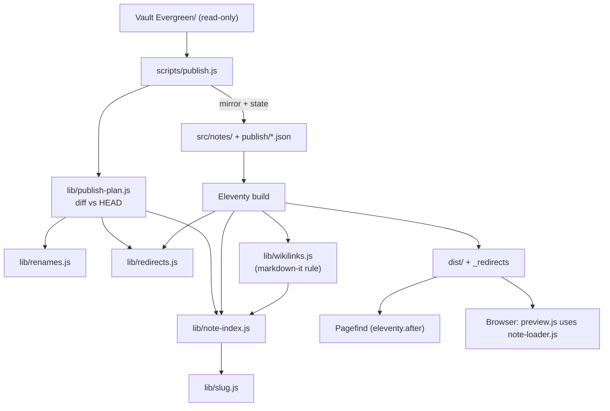
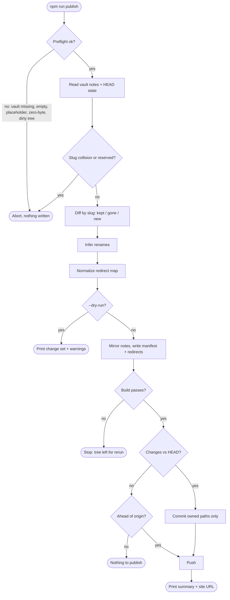
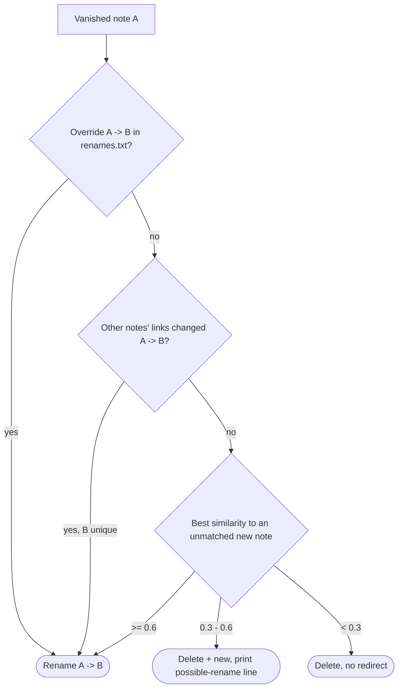

# notes.seanvoisen.com Public Notes Site - Plan

## Goal Capsule

- **Objective:** Sean's evergreen notes are publicly readable at notes.seanvoisen.com on a site that clearly belongs to the seanvoisen.com brand while looking distinct from it, and he can publish changes from his Obsidian vault with one command.
- **Means:** A standalone Eleventy site on the same stack as seanvoisen.com, fed by a local publish command that mirrors the vault's `Evergreen/` folder into the repo (Key Decisions; KTD4).
- **Product authority:** The Product Contract owns behavior and scope. The Figma design, once it exists, owns the visual layer (R16). Key Technical Decisions own mechanism within the cited requirements.
- **Execution profile:** New repository at this folder, which is not yet a git repository; U1 initializes it. The work lands as a series of commits on one branch, with no PR split. U1–U6 are buildable now. U7 is gated (see stop conditions).
- **Stop conditions:**
  - Do not start U7 until Sean provides a Figma file link for the notes site. Finish U1–U6 and stop there if there is none.
  - Never write to the Obsidian vault. The publish command only reads it.
  - Do not create or change external accounts or resources (GitHub repo, Netlify site, DNS), and do not modify the seanvoisen.com repo. Sean does these; see Operational Notes.
- **Who finishes:** An executor builds U1–U6 and verifies them locally. Sean connects the remote, Netlify, and DNS, runs the first real publish, and provides the Figma design that unblocks U7.
- **Open blockers:** None for U1–U6. U7 waits on the Figma design.

---

## Product Contract

### Summary

A small static site publishes every note in the vault's `Evergreen/` folder. It has full-text search, hover previews of linked notes, and a "Links to this note" section on each note. A local publish command syncs the notes, builds the site, and deploys it. Note URLs come from note titles, and renamed notes get redirects. The visual direction is a note sheet resting on a desk surface. It will be refined in Figma before it is built, and it is meant to grow into Andy Matuschak-style stacked sheets in a later round.

### Problem Frame

Sean writes evergreen notes in an Obsidian vault stored in iCloud (`Research Notes/Evergreen/`, 16 notes today). The notes are densely cross-linked, and they link out to literature notes in `References/` that are not meant to be public. Obsidian Publish would put them online, but it ties the site to Obsidian's hosting, and its theming can't match the brand Sean has built for seanvoisen.com: a monochrome token system, Outfit and IBM Plex Sans, and a single accent hue reserved for hover and focus. No off-the-shelf open-source publisher fits both the brand and the reading experience he wants without significant customization. The closest one, Quartz, makes the visual work harder rather than easier.

Notes have been tried once before. In August 2026, Sean retired a hand-maintained Notes section on seanvoisen.com because it cost more to maintain than it returned. Any new attempt has to keep upkeep near zero: the vault stays the only place notes are written, and publishing is a single command.

### Key Decisions

- **Standalone Eleventy site, not Quartz and not inside the seanvoisen.com repo.** Quartz's main head start for these notes is hover previews. Its theming and SPA router make the desk-and-sheet look and the later stacked sheets harder to build. A separate repo keeps blog and notes deploys independent. (session-settled: user-approved — chosen over Quartz v5 and over a second build inside the seanvoisen.com repo: same stack Sean already maintains, full control of markup for the look and future sheets.) Governs R15.
- **The whole `Evergreen/` folder is the publish set.** Folder membership is the only rule, with no per-note flag. (session-settled: user-approved — chosen over a per-note `publish: true` flag and over also publishing `References/`: simplest rule, matches how Sean already separates evergreen notes.) Governs R1, R2.
- **Links to anything unpublished render as plain text.** (session-settled: user-approved — chosen over a muted "not public" link style and over removing the link: citations to literature notes keep reading as ordinary references.) Governs R4.
- **Publishing is one local command.** The host never reads the vault. (session-settled: user-approved — chosen over building locally and uploading output, and over putting the vault folder in git: Sean decides when notes go live, and the deploy history is kept.) Governs R3.
- **URLs are title slugs, and renames create redirects.** (session-settled: user-approved — chosen over accepting broken links on rename and over stable frontmatter IDs: readable URLs with no extra work in Obsidian.) Governs R5, R6, R7, R9.
- **On a URL collision, the live note wins.** (session-settled: user-approved — chosen over never reusing old URLs and over failing the publish: a new note with an old title is likely on a related idea.) Governs R8.
- **Stacked sheets are deferred.** v1 uses normal page-to-page navigation plus hover previews. (session-settled: user-directed — chosen over requiring Andy-style sheets in v1 and over a lighter tab-strip version.)
- **The home page is an intro note titled "Home".** Sean writes it to explain what the notes are and how to read them. Once sheets ship, it becomes the first sheet. (session-settled: user-directed — chosen over an intro plus a full note list, and over a list only.) Governs R10.
- **Backlinks are the only note-page extra in v1.** (session-settled: user-directed — chosen over also including topic tags, last-updated dates, or a graph view.) Governs R11.
- **"Desk & sheet" is the visual direction, to be refined in Figma before building.** (session-settled: user-directed — chosen over a warm paper tone, a serif body, and a persistent accent hue. Sean wants to iterate on the design in Figma before any visual build.) Governs R16.
- **The sheet treatment and the preview mechanism are built with stacked sheets in mind.** Both already handle "show another note beside this one," so the later sheets round can extend them instead of replacing them.

### Requirements

**Publishing**

- R1. Every note in the vault's `Evergreen/` folder is published, and nothing outside that folder is (`Inbox.md`, `Top of mind.md`, `References/`).
- R2. A note with no frontmatter publishes like any other note.
- R3. A single local command copies `Evergreen/` from the vault into the site, builds the site, commits, and pushes, and the host deploys on push.
- R4. A wikilink whose target isn't published (a `References/` note or a note that doesn't exist) renders as plain text, using the link's alias when it has one.

**URLs and redirects**

- R5. Each note's URL is a slug of its title.
- R6. A note's URL changes only when its title changes. Editing its body or tags leaves the URL alone.
- R7. When a note's title changes, its old URL permanently redirects to its current URL, and redirect chains resolve directly to the final URL.
- R8. When a live note's URL matches an existing redirect's source, the live note keeps the URL, the redirect is dropped, and the publish step prints a warning naming both notes.
- R9. A note deleted from or moved out of `Evergreen/` disappears from the site with no redirect.

**Reading**

- R10. The site's home page is an intro note titled "Home" that explains the notes and how to read them, and its links behave like links in any note.
- R11. Each note page lists the published notes that link to it under a "Links to this note" heading. Home is not listed.
- R12. On pointer devices, hovering a link to another published note (in the body or in backlinks) shows a preview of that note. On touch devices, tapping the link opens the note.
- R13. Every page offers full-text search across published note titles and bodies.

**Look and feel**

- R14. The site works at phone widths.
- R15. The site uses seanvoisen.com's typefaces (Outfit for headings and UI, IBM Plex Sans for body) and builds on its token system, so it reads as the same brand.
- R16. The site follows the desk-and-sheet direction as finalized in the Figma design: each note sits on a sheet over a desk surface.
- R17. The site has light and dark modes with a toggle that remembers the reader's choice, like seanvoisen.com.

### Key Flows

- F1. Publishing an update
  - **Trigger:** Sean has written, edited, renamed, or deleted notes in `Evergreen/` and wants them live.
  - **Steps:** He runs the publish command. It syncs `Evergreen/`, works out renames and redirects, and prints any URL-collision warnings. Then it builds, commits, and pushes, and the host deploys.
  - **Outcome:** The site matches `Evergreen/` as of that run, and old URLs still resolve where R6–R8 say they should.
  - **Covered by:** R1–R4, R6–R9
- F2. Reading
  - **Trigger:** A reader arrives at the home page, or at a note from an outside link.
  - **Steps:** The reader reads the intro note. They hover a linked note to preview it, then open it. They follow its backlinks to related notes, or search for a term.
  - **Outcome:** The reader moves through the notes by link, preview, backlink, and search without hitting a dead link.
  - **Covered by:** R4, R10–R13

### Acceptance Examples

- AE1. **Covers R4.** **Given** "Action can precede cognition" links to `[[Kirsh - 1994 - On Distinguishing Epistemic from Pragmatic Action|Kirsh, D. and Maglio, P. (1994) …]]`, **when** the site builds, **then** the note shows "Kirsh, D. and Maglio, P. (1994) …" as plain text with no link styling.
- AE2. **Covers R4.** **Given** a note links to `[[Offices and workspaces are complex ecologies of work]]`, which exists nowhere in the vault, **then** the title renders as plain text.
- AE3. **Covers R2.** **Given** "Digital collaborative environments tend to be neat" has no frontmatter, **then** it publishes, gets its URL from its title, and appears in search and backlinks.
- AE4. **Covers R7.** **Given** note A was published at `/a`, **when** Sean renames it to B and publishes, **then** `/a` permanently redirects to `/b`. **When** he later renames it to C, **then** `/a` and `/b` both redirect straight to `/c`.
- AE5. **Covers R7, R8.** **Given** A was renamed to B (so `/a` redirects to `/b`), **when** Sean renames it back to A, **then** the note lives at `/a`, the `/a` → `/b` redirect is gone, and `/b` redirects to `/a`.
- AE6. **Covers R8.** **Given** `/a` redirects to `/b` because of an earlier rename, **when** Sean creates a new, unrelated note titled A and publishes, **then** `/a` serves the new note, the redirect is dropped, and the publish output warns that the new note took over a redirect pointing at B.
- AE7. **Covers R9.** **Given** a note is moved from `Evergreen/` to `Inbox/`, **when** Sean publishes, **then** its URL returns not-found and no redirect is created.
- AE8. **Covers R12.** **Given** a reader on a phone taps a link to another published note, **then** the note opens with no preview step.

### Success Criteria

- Someone who knows seanvoisen.com recognizes the notes site as Sean's, and can still tell at a glance that they're in the notes rather than the blog.
- Publishing after an editing session needs no step beyond running the command and reading its output.

### Scope Boundaries

**Deferred for later**

- Andy-style stacked sheets, including the intro note as the first sheet.
- Topic tag pages, last-updated dates, and a graph view.
- A link to the notes site from seanvoisen.com's navigation (a change to that repo).
- A single shared token file across both sites. v1 copies the tokens, so brand changes have to be made in both places.
- Publishing `References/` literature notes.

**Outside this product's identity**

- Depending on Obsidian Publish or any Obsidian-hosted service.
- Editing or publishing from the web. The vault stays the only place notes are written.

**Deferred to Follow-Up Work**

- A `/notes/*` → notes.seanvoisen.com rule in seanvoisen.com's `_redirects`, keeping its existing `/philosophy-for-designers/` exception above it. It recovers the inbound links that broke when the old Notes section was retired. This is a small change in the other repo.

**Considered and not built**

- **Mass-deletion threshold** (abort when more than some share of notes would vanish at once). The preflight aborts when the vault is missing or `Evergreen/` is empty (KTD7). Beyond that, the guard is the removal list every run prints, plus `--dry-run`. Revisit if a publish ever removes notes Sean didn't mean to remove.
- **Warning when two notes swap titles.** Both URLs stay live, so no redirect logic is involved; a swap only changes what an outside link lands on. Revisit if swaps actually happen.
- **Build-time crawl for broken internal links.** The resolver only emits hrefs to notes it has confirmed are live (KTD1), so a separate crawler would duplicate that check. Revisit if a hand-written href is ever added to a template.
- **Sharing the light/dark choice with seanvoisen.com.** Browsers store it separately for each domain, and sharing it would need a cookie change on both sites.
- **"Search was updated, reload" notice** for tabs left open across a deploy. It's rare, and a reload fixes it.
- **Re-normalizing the redirect map at build time.** The publish command already normalizes it (KTD6), and Netlify serves a live file over a same-path redirect anyway. Revisit if `publish/redirects.json` ever gets edited by hand.

### Dependencies / Assumptions

- **Figma design (blocks U7 only).** Sean will iterate on the desk-and-sheet direction in Figma. Layout, the search UI's appearance, the hover preview's appearance, the masthead, and the dark-mode palette all come from that design.
- The Home note is written and kept in the site repo, not in the vault, since it isn't an evergreen note.
- Hosting is Netlify on the notes.seanvoisen.com subdomain, matching seanvoisen.com. *(Assumption.)*
- Evergreen notes currently use no Obsidian syntax beyond wikilinks: no callouts, embeds, block references, heading links, highlights, comments, math, or code fences. Supporting those is not required for v1.
- The vault has Obsidian's "Automatically update internal links" setting on (`.obsidian/app.json` sets `alwaysUpdateLinks: true`). KTD5 relies on it.

### Sources / Research

- seanvoisen.com source (separate repo, local at `~/src/seanvoisen.com`):
  - Eleventy 3.x and Netlify (`package.json`, `README.md`, `_redirects`).
  - The token layers and the hover/focus-only accent are in `src/_includes/css/global.css`.
  - Fonts are in `src/assets/fonts/`, and the theme toggle is in `src/_includes/head/theme-toggle.njk`.
  - Commit `7ae0a0b` retired the old Notes section.
- Vault: `~/Library/Mobile Documents/iCloud~md~obsidian/Documents/Research Notes/` (`Evergreen/`, `References/`, `Inbox.md`, `Top of mind.md`).
- Quartz v5, the evaluated alternative: https://quartz.jzhao.xyz/. Its StackedPages plugin is a tab strip rather than sliding columns: https://quartz.jzhao.xyz/plugins/stackedpages.
- Rough visual sketch of the four look options (desk & sheet chosen). It is machine-local and kept only as long as the temp directory survives: `/tmp/compound-engineering-501/ce-brainstorm-visual/notes-site/screens/001-differentiation.html`. If it's missing, nothing is blocked; this contract and the Figma design govern.

---

## Planning Contract

**Product Contract preservation:** changed: R10 names the intro note "Home" (Sean's direction after the brainstorm). R11 now states that Home is not listed in backlinks (Sean confirmed this during planning). The Problem Frame gained one paragraph about the retired Notes section. The brainstorm's three deferred planning questions are resolved by KTD4–KTD5, KTD10, and KTD9 and were removed from the Product Contract. No other scope change.

### Key Technical Decisions

- KTD1. **One shared note index and a custom markdown-it wikilink rule, not eleventy-plugin-interlinker.**
  - The plugin needs `title` frontmatter, which the notes lack. It matches titles case-sensitively, it renders dead links as `/stubs/` anchors, and its backlinks depend on mutation order across pages.
  - Instead, one pure module builds the index (titles, aliases, outbound links, backlinks) from the notes. Both the Eleventy build and the publish command use it, so the site and the publish output never disagree about what resolves.
  - The renderer emits an href only for a link it resolved to a live note, and renders plain text otherwise (R4).
  - (session-settled: user-approved — chosen over eleventy-plugin-interlinker with an overridden resolver: notes have no `title` frontmatter and links must resolve the way Obsidian resolves them.) Governs R4, R11.
- KTD2. **A pinned, in-repo slug function, frozen by a golden test.** Every URL depends on it, so it can't drift with a dependency upgrade.
  - The steps, in order: NFC-normalize, fold curly apostrophes to straight, drop apostrophes, transliterate accents, lowercase, collapse each run of other characters to `-`, then trim.
  - Example: "Good interfaces should support all three of Bruner's modes of representation" becomes `good-interfaces-should-support-all-three-of-bruners-modes-of-representation`.
  - Reserved slugs (`pagefind`, `assets`, `404`, `home`, the empty slug) and any two live titles sharing a slug abort the publish and fail the build, naming the titles involved.
  - Governs R5, R6.
- KTD3. **A note's title is its vault filename, NFC-normalized. Links resolve the way Obsidian resolves them.**
  - Resolution is case-insensitive and NFC-normalized.
  - The resolver strips a leading folder path, any `#heading` part, and a trailing `.md`. It also matches `aliases` frontmatter (aliases never create URLs).
  - `![[embeds]]` and links to non-`Evergreen/` notes render as plain text.
  - Display text is the alias if there is one, otherwise the link target as written, minus any `#…` part.
  - Self-links render as plain links with no preview.
  - Notes in subfolders of `Evergreen/` publish too, and the subfolder never appears in the URL.
  - Governs R1, R4.
- KTD4. **Publish state lives in git, and `HEAD` is always the baseline.** The repo holds:
  - the mirrored notes (`src/notes/`)
  - `publish/manifest.json`: slug → title and source path for each live note
  - `publish/redirects.json`: the normalized redirect map
  - `publish/renames.txt`: Sean's manual overrides, one `old title -> new title` per line

  Previous note bodies and links are read from `HEAD`'s copy of `src/notes/`, so the manifest stays small. A missing manifest means a first publish: every note is new, with no deletions and no redirects. Governs R3, R7.
- KTD5. **Rename inference is layered, and an uncertain rename publishes with a warning.** The command pairs notes that vanished with notes that appeared, one-to-one, by strongest evidence first:
  1. An override line in `publish/renames.txt` always wins. A line can also be added later to create a redirect a previous publish missed.
  2. Link-rewrite evidence. Obsidian rewrites inbound links on rename, so another note's links changing from `[[A]]` to `[[B]]` between `HEAD` and now marks A→B as a rename, even when B's body was heavily rewritten.
  3. Body similarity: Jaccard over 3-word shingles of the frontmatter-stripped body. Starting thresholds: ≥ 0.6 counts as a rename, and 0.3–0.6 gets a warning. Tune them against real renames.

  The candidates on the "old" side are the `HEAD` notes whose slug vanished, plus any `HEAD` note whose slug is still live but whose current body has similarity below 0.3 to its own `HEAD` body. The second group catches "rename A→B and create a new note titled A" in one run: old A pairs with B, and KTD6 then drops the `a → b` edge with the R8 warning.

  An unmatched pair is treated as a delete plus a new note. The output prints a "possible rename" line containing the exact override line to paste. (session-settled: user-directed — chosen over stopping the publish until an override exists, and over prompting interactively: publishing never blocks, and an override can add the redirect later.) Governs R7, R9.
- KTD6. **One normalization function owns the redirect map, and it runs on every publish.** It adds new rename edges and repoints older entries to the final target, which flattens chains. It drops:
  - entries whose source is now a live slug (with the R8 warning when that entry pointed at a different note)
  - entries whose final target is no longer live (consistent with R9)
  - self-redirects

  Netlify's `_redirects` is generated from `publish/redirects.json` at build time as plain `301` rules without the `!` force flag, so a live file always wins anyway. Governs R7, R8, R9.
- KTD7. **The publish command is defensive about its inputs and narrow in what it commits.** The vault is read-only to it. `VAULT_PATH` names the vault root, and the command reads `VAULT_PATH/Evergreen/`. Its owned paths are `src/notes/`, `publish/`, and `src/index.md` (Home), so editing Home and running the command ships the change. It aborts before writing anything when:
  - the vault path is missing
  - `Evergreen/` yields zero notes
  - any zero-byte note or legacy `.icloud` placeholder exists (a cheap fallback; current macOS iCloud keeps evicted files under their real names and downloads them on read)
  - a slug collides (KTD2)
  - files outside its owned paths have uncommitted changes

  The preflight cannot detect edits from another device that haven't synced yet; the always-printed removal list and `--dry-run` are the guard there.

  It mirrors by clearing `src/notes/**/*.md` and re-copying, so a case-only rename on case-insensitive APFS updates the displayed title. Before staging, it removes `src/notes/` from git's index (keeping the files), so git records the on-disk filename case despite macOS's `core.ignorecase`. It commits only its owned paths, makes no empty commit, and treats "ahead of origin" as "just push" on a rerun after a failed push. `--dry-run` prints the full change set and warnings without writing. Governs R3.
- KTD8. **Search uses Pagefind 1.6's Component UI, indexed by an `eleventy.after` hook.** The hook runs in both `build` and `serve`, so dev search stays current. `data-pagefind-body` wraps only a note's title and body; backlinks carry `data-pagefind-ignore`. Once any page has a body marker, Pagefind skips pages without one, so Home (which has none) stays out of the index. The `--pf-*` variables are set on the Pagefind component selectors to the copied `light-dark()` semantic tokens, so the search UI follows whatever color scheme the theme toggle sets. Pagefind is a pinned devDependency. Governs R13, R17.
- KTD9. **Hover previews are vanilla progressive enhancement, split into a note loader and a preview renderer.**
  - The loader fetches a note's canonical URL, extracts its content region, and caches it. A later stacked-sheets round reuses the loader.
  - The renderer shows a single preview positioned near the link. It is triggered by `pointerenter` with a mouse or pen (after a short delay) or by `:focus-visible`.
  - The preview is a visual supplement: `aria-hidden="true"`, not tied to the link with `aria-describedby`, and with its links removed from the tab order. The link text stays the accessible name, and keyboard and screen-reader users reach the note by following the link.
  - The preview stays open while the link or the preview is hovered, and closes on leave (after a grace delay), on Esc, and on blur.
  - Links inside a preview work for pointer users but don't open nested previews.
  - Touch input never triggers a preview. A failed fetch shows nothing.
  - Governs R12.
- KTD10. **Tokens are copied verbatim, and the notes look is a separate scheme layer.**
  - The `:root` palette, semantic, type, and space blocks from seanvoisen.com's `global.css` go into `src/_includes/css/tokens.css` unchanged, with a header naming the source commit, so drift can be diffed later.
  - Notes-specific semantic tokens (desk, sheet, preview) live in `notes.css`, following the named-scheme pattern `global.css` already describes.
  - CSS is inlined through the same postcss filter seanvoisen.com uses.
  - The three woff2 font files are copied, not hot-linked: Netlify sends no CORS header for them.
  - Governs R15, R16, R17.
- KTD11. **Home is `src/index.md`, titled "Home", served at `/`.** It uses the same wikilink resolver as the notes. It never appears in backlinks or search. Each publish lists any Home link that no longer resolves, because Obsidian's link updating can't reach a file outside the vault. Governs R10.
- KTD12. **Copy seanvoisen.com's Eleventy conventions, with two changes.** Copied:
  - a thin `eleventy.config.js` that imports one barrel per concern from `src/_config/`
  - ESM scripts with `process.loadEnvFile` and a `.env.example`
  - `main().catch` entry points

  Changed:
  - `markdownTemplateEngine: false`, so `{{` in a note can't break the build
  - no `<base href>` tag, so preview fetches and Pagefind paths resolve from the root
- KTD13. **Tests use Node's built-in `node:test`, with no test framework dependency.** Pure modules get unit tests. One integration test builds the site from fixture notes with Eleventy's programmatic API and checks the emitted HTML and `_redirects`.

### High-Level Technical Design

**Components.** The pure modules in `lib/` are the single source of truth that the build and the publish command share.



**Publish pipeline.** Every abort happens before anything is written.



**Rename decision for each vanished note.** This applies KTD5.



### Assumptions

- The Netlify build image runs Node 24, pinned with `.nvmrc`. Local Node is v24.
- Sean will create the GitHub remote, the Netlify site, and the DNS record (Operational Notes). Until a remote exists, the publish command's push step reports "no remote configured" and exits non-zero after committing.
- The rename-similarity thresholds (KTD5) are starting values, to be tuned against real renames.

---

## Output Structure

```text
.
├── .env.example                # VAULT_PATH
├── .gitignore
├── .nvmrc
├── eleventy.config.js
├── netlify.toml
├── package.json
├── lib/                        # pure modules shared by build + publish
│   ├── slug.js
│   ├── note-index.js
│   ├── wikilinks.js
│   ├── renames.js
│   ├── redirects.js
│   └── publish-plan.js
├── publish/
│   ├── manifest.json
│   ├── redirects.json
│   └── renames.txt
├── scripts/
│   └── publish.js
├── src/
│   ├── index.md                # Home
│   ├── _redirects.njk
│   ├── 404.njk
│   ├── notes/                  # mirrored from the vault by publish; do not edit
│   │   └── notes.11tydata.js   # survives the mirror; carries the "generated" notice
│   ├── _config/
│   ├── _data/
│   ├── _layouts/               # base.njk, note.njk
│   ├── _includes/              # css/tokens.css, css/notes.css, head/, partials/
│   └── assets/                 # fonts/, js/note-loader.js, js/preview.js
└── test/
    ├── fixtures/notes/
    └── *.test.js
```

---

## Implementation Units

### U1. Scaffold the Eleventy site with brand tokens, fonts, theme toggle, and Home

**Goal:** A buildable, deployable site skeleton that already reads as Sean's brand, with plain token-based styling until U7.

**Requirements:** R10, R14, R15, R17; KTD10, KTD11, KTD12.

**Dependencies:** None.

**Files:**
- `package.json`, `eleventy.config.js`, `.nvmrc`, `netlify.toml`, `.gitignore`, `.env.example`
- `src/_config/plugins.js`, `src/_config/plugins/markdown.js`, `src/_config/filters.js`, `src/_config/filters/postcss.js`
- `src/_data/site.js`
- `src/_layouts/base.njk`
- `src/_includes/head/meta.njk`, `src/_includes/head/css-inline.njk`, `src/_includes/head/theme-toggle.njk`
- `src/_includes/partials/header.njk`, `src/_includes/partials/footer.njk`
- `src/_includes/css/tokens.css`, `src/_includes/css/notes.css`
- `src/assets/fonts/*.woff2`
- `src/index.md`
- `src/404.njk`
- `src/notes/notes.11tydata.js` (created here as a stub, so the notice in step 7 lives in a file the mirror never clears)
- `test/site.test.js`

**Approach:**
1. Initialize the git repository.
2. Mirror seanvoisen.com's config shape: a thin root config with barrels in `src/_config/`, input `src`, output `dist`, and `markdownTemplateEngine: false` (KTD12).
3. Copy the token blocks, fonts, postcss filter, and theme toggle. The toggle keeps the `theme` key and the `document.documentElement.style.colorScheme` mechanism, which every `light-dark()` token follows. Drop `<base href>`.
4. Add an empty notes scheme layer in `notes.css`, with plain readable layout rules that U7 will replace.
5. Write a placeholder Home with a link back to seanvoisen.com in the header. Sean writes the real copy.
6. Add a `404.html` page on the base layout. It says the note isn't published or has moved, and links to Home.
7. Point `netlify.toml` at `npm run build` with publish dir `dist`.
8. Put a header comment in `src/notes/notes.11tydata.js` saying the folder's Markdown is mirrored from the vault by `npm run publish` and must not be edited by hand. Don't add any other Markdown file to `src/notes/`: the mirror clears every `.md` file there.

**Patterns to follow:** `~/src/seanvoisen.com/eleventy.config.js`, `src/_config/plugins/markdown.js`, `src/_includes/head/css-inline.njk`, `src/_layouts/base.njk` (init script), `src/_includes/head/theme-toggle.njk`, `scripts/addbook.js` (env loading).

**Test scenarios:**
- The site builds from an empty `src/notes/` and emits `/index.html` with the title "Home".
- The build emits `dist/404.html` with a link to Home.
- Built pages contain no `<base>` element.
- The inlined CSS contains the copied token names (`--background-color`, `--link-hover-color`) and both font-face declarations.

**Verification:** `npm run build` succeeds. The home page renders in the browser in both color schemes, the toggle persists across reloads, and there is no horizontal scroll at 375px.

### U2. Note index, slug function, wikilink rendering, note pages, and backlinks

**Goal:** Mirrored notes become note pages at title-slug URLs, with Obsidian-faithful link resolution, plain-text dead links, and a "Links to this note" list.

**Requirements:** R1, R2, R4, R5, R6, R10, R11; KTD1, KTD2, KTD3, KTD11. Covers AE1, AE2, AE3.

**Dependencies:** U1.

**Files:**
- `lib/slug.js`, `lib/note-index.js`, `lib/wikilinks.js`
- `src/_data/noteIndex.js`
- `src/notes/notes.11tydata.js` (fill in the U1 stub)
- `src/_layouts/note.njk`
- `src/_config/plugins/markdown.js` (register the rule)
- `test/slug.test.js`, `test/note-index.test.js`, `test/wikilinks.test.js`, `test/site.test.js`
- `test/fixtures/notes/*.md`

**Approach:**
1. `slug.js` implements KTD2 and exports the reserved list.
2. `note-index.js` reads a notes directory recursively and builds the lookup (titles plus aliases, normalized per KTD3), outbound links per note, and deduped backlinks. It excludes self-links, Home, and links that don't resolve. Collisions throw with both titles named.
3. The Eleventy side builds the index once per build in an `eleventy.before` hook, and that same index serves the markdown-it rule and the `noteIndex` global data.
4. `notes.11tydata.js` computes `title` from the filename and `permalink` from the slug, and sets the layout to `note.njk`.
5. `note.njk` wraps the title and body in the content region the preview loader extracts (`data-note-content`). The backlinks section sits outside that region. The section, heading included, is omitted when a note has no backlinks.
6. Every internal note link carries `data-note-link`.
7. Home renders through the same rule and is left out of the index's backlink sources.
8. The index's unresolved Home links are exposed so the publish command can report them.

**Execution note:** Write the slug golden test first, against all 16 current Evergreen titles, before any URL is emitted.

**Patterns to follow:** The barrel registration in `~/src/seanvoisen.com/src/_config/plugins.js`, and the `eleventy.before` hook usage at `eleventy.config.js:45` there.

**Test scenarios:**
- The golden test maps all 16 current Evergreen titles to fixed slugs, including "Bruner's" → `bruners` and "messy (scruffy) spaces" → `messy-scruffy-spaces`.
- A curly-apostrophe title and a straight-apostrophe title produce the same slug.
- An NFD-encoded title and its NFC form produce the same slug.
- Two titles that slugify identically cause the index build to throw, naming both.
- A title whose slug is reserved (`Pagefind`) throws.
- Covers AE1. `[[Kirsh - 1994 - On Distinguishing Epistemic from Pragmatic Action|Kirsh, D. and Maglio, P. (1994) …]]` with no such note renders the alias as plain text, not as an anchor.
- Covers AE2. `[[Offices and workspaces are complex ecologies of work]]` with no such note renders the title as plain text.
- `[[action can precede cognition]]` (different case) resolves to "Action can precede cognition".
- `[[Evergreen/Action can precede cognition]]` resolves, and `[[References/Kay - 1993 - The Early History of Smalltalk]]` renders as plain text.
- `[[Action can precede cognition#Some heading]]` links to the note, and the display text omits `#Some heading`.
- A note whose `aliases` frontmatter lists "Epistemic first" is reachable through `[[Epistemic first]]`.
- `![[Some note]]` renders as plain text.
- A `[[link]]` inside inline code or a fenced code block stays literal.
- A note linking to itself renders a link without `data-note-link`.
- Covers AE3. A fixture note with no frontmatter builds at its title slug and shows up as a backlink source.
- A note that links to another note twice appears once in that note's backlinks. A note never lists itself, and Home never appears in any backlinks list.
- A fixture note that nothing links to renders no "Links to this note" heading.
- Integration: building the fixture site emits each note at `/<slug>/index.html`, with backlinks rendered outside `data-note-content`.

**Verification:** Unit and integration tests pass. A manual build over a real copy of `Evergreen/` emits 16 note pages, and the Kirsh citations appear as plain text.

### U3. Redirect map normalization and Netlify `_redirects` generation

**Goal:** Renames produce flattened, collision-safe permanent redirects deployed with the site.

**Requirements:** R7, R8, R9; KTD6. Covers AE4, AE5, AE6, AE7.

**Dependencies:** U2 (slug function).

**Files:**
- `lib/redirects.js`
- `publish/redirects.json` (initially `{}`)
- `src/_redirects.njk`
- `src/_data/redirects.js`
- `test/redirects.test.js`, `test/site.test.js`

**Approach:**
1. `normalize(redirects, renameEdges, liveSlugs)` returns the new map plus warnings, per KTD6.
2. The build reads `publish/redirects.json` as already normalized and renders `_redirects` with one `/<old>/ /<new>/ 301` line per entry.
3. Check that Eleventy emits a file named `_redirects`, not one skipped for its leading underscore.

**Test scenarios:**
- Covers AE4. Rename A→B gives `{a: b}`. A later rename B→C gives `{a: c, b: c}`.
- Covers AE5. With `{a: b}`, renaming B→A drops `a` and adds `b → a`.
- Covers AE6. With `{a: b}`, a live new note at slug `a` drops the `a` entry and returns a warning naming the new note and B.
- Covers AE7. With `{a: b}`, when B is deleted (not live), the `a` entry is dropped and no entry for `b` is created.
- A rename edge whose old and new slugs are equal (a case-only rename) adds nothing.
- Integration: a fixture `publish/redirects.json` renders a `dist/_redirects` with exactly those lines, and none use `!`.

**Verification:** Tests pass, and `dist/_redirects` matches `publish/redirects.json` after a build.

### U4. Publish command with rename inference

**Goal:** `npm run publish` turns vault edits into a committed, pushed site update per F1, safely and with a readable report.

**Requirements:** R1, R3, R7, R8, R9; KTD4, KTD5, KTD7, KTD11. Covers F1.

**Dependencies:** U2, U3.

**Files:**
- `lib/renames.js`, `lib/publish-plan.js`
- `scripts/publish.js`
- `publish/renames.txt` (an empty file with a usage comment)
- `publish/manifest.json` is not created by this unit. The first real publish writes it, so a dry run before then sees a first publish.
- `package.json` (the `publish` script)
- `.env.example`
- `test/renames.test.js`, `test/publish-plan.test.js`

**Approach:**
1. `publish-plan.js` is pure: given the current vault notes, `HEAD`'s notes and state, and the overrides, it returns the change set (added, updated, removed, renames), the new manifest and redirect map, the unresolved Home links, and warnings. `renames.js` implements KTD5's layered pairing.
2. `scripts/publish.js` does the I/O:
   1. Load `VAULT_PATH`.
   2. Run the preflight (KTD7).
   3. Read `HEAD`'s state via git.
   4. Call the plan.
   5. On `--dry-run`, print and stop.
   6. Otherwise mirror the notes, write the state, run the build, commit only the owned paths, and push.
   7. Print the summary and the site URL.
3. Shell out to git with argument arrays, never through a shell string.

**Patterns to follow:** `~/src/seanvoisen.com/scripts/addbook.js` (shebang, `process.loadEnvFile`, hand-rolled flag parsing, `main().catch`, JSDoc per function).

**Test scenarios:**
- A first publish (no manifest at `HEAD`) marks every note as added, with zero removals and zero redirects.
- A body-only edit gives "updated" with no redirect (R6).
- Rename A→B with an unchanged body pairs by similarity and yields `a → b`.
- Rename A→B plus a heavy rewrite, where another note's link changed from `[[A]]` to `[[B]]`, pairs by link-rewrite evidence.
- Rename A→B plus a heavy rewrite with no inbound links and similarity between 0.3 and 0.6: A is removed, B is added, there is no redirect, and the warning contains the line `A -> B`.
- Rename A→B plus a rewrite with no inbound links and similarity below 0.3: A is removed, B is added, and there is no redirect and no possible-rename warning.
- Override `A -> B` in `renames.txt` pairs them even at similarity 0.
- An override for a rename missed in an earlier publish (A no longer in `HEAD`'s notes, B live) adds `a → b`.
- Two vanished and two new notes pair one-to-one by best score, not greedily.
- Rename A→B plus a new, unrelated note titled A in the same run: old A pairs with B through the changed-body candidate rule (KTD5), `/a` serves the new note, no `a → b` redirect remains, and the R8 warning names the new note and B.
- A Home link to a title that is no longer live appears in the warnings.
- Preflight: a zero-byte note aborts, naming the note. So does a legacy `Evergreen/.Some note.md.icloud` placeholder.
- Preflight: a missing vault path aborts, and so does an empty `Evergreen/`.
- Preflight: a modified file outside the owned paths aborts, and nothing is written.
- An uncommitted edit to `src/index.md` does not abort the preflight and is included in the publish commit.
- A case-only rename (same slug) updates the mirrored filename and the displayed title with no redirect, and the path committed to `HEAD` has the new case.

**Verification:** Tests pass. `npm run publish -- --dry-run` against the real vault reports 16 added notes, no removals, and the expected plain-text links, and writes nothing (`git status` is clean afterwards).

### U5. Full-text search with Pagefind

**Goal:** Every page has a search entry point that finds notes by title and body text.

**Requirements:** R13; KTD8.

**Dependencies:** U2.

**Files:**
- `eleventy.config.js` (the `eleventy.after` hook)
- `src/_config/plugins/pagefind.js`
- `src/_layouts/base.njk`, `src/_layouts/note.njk` (search markup, `data-pagefind-body`, `data-pagefind-ignore`)
- `src/_includes/css/notes.css` (baseline `--pf-*` mapping to tokens)
- `package.json`
- `test/site.test.js`

**Approach:** Index `dist/` with the Pagefind Node API after each build. Put the Component UI's modal trigger in the header on every page. Set the `--pf-*` variables on the Pagefind component selectors to the `light-dark()` semantic tokens (KTD8), with no `prefers-color-scheme` media query. U7 owns the final look.

**Test scenarios:**
- Integration: after a fixture build, `dist/pagefind/` exists, and the indexed page count equals the number of fixture notes (Home is excluded).
- Integration: a note page's backlinks section carries `data-pagefind-ignore`, and the body wrapper carries `data-pagefind-body`.

**Verification:** In the browser, searching a phrase from one note's body returns that note first. Searching a note's title doesn't return the notes that only backlink it. Search works under `npm start` after an edit. With the OS in light mode and the toggle set to dark, the search modal renders dark, and the reverse.

### U6. Hover previews

**Goal:** Pointer and keyboard users can preview a linked note without leaving the page. Touch users navigate directly.

**Requirements:** R12; KTD9. Covers AE8.

**Dependencies:** U2.

**Files:**
- `src/assets/js/note-loader.js`, `src/assets/js/preview.js`
- `src/_layouts/base.njk` (module script)
- `src/_includes/css/notes.css` (baseline preview styles)
- `eleventy.config.js` (passthrough for `src/assets/js`)

**Approach:**
1. `note-loader.js` exposes "load note by URL", returning the parsed `data-note-content` fragment from a per-session cache. Keep it free of popover concerns so sheets can reuse it.
2. `preview.js` delegates on `a[data-note-link]`. It gates on the event's `pointerType` (`mouse` or `pen`), plus `focus-visible` for keyboard.
3. It positions one preview element near the link, flipping to stay inside the viewport. Mark it `aria-hidden="true"` and give its links `tabindex="-1"` (KTD9).
4. Links inside the preview don't trigger nested previews.
5. Use a delay of about 300ms before showing and a grace period before hiding. Tune both by feel.

**Execution note:** This is mostly browser behavior. Prove it with a manual pass in the browser across mouse, keyboard, and touch emulation, not with unit tests.

**Test scenarios:**
- Hovering a body link with a mouse shows the target note's title and body after the delay, and not its backlinks.
- Moving the pointer from the link into the preview keeps it open. Leaving both closes it after the grace period.
- Tabbing to a link shows its preview. Esc closes it. Tabbing onward moves focus to the next link, not into the preview.
- With a screen reader, focusing a note link announces only the link text, not the preview's contents.
- Hovering a backlink entry previews the linking note.
- Covers AE8. With touch emulation, tapping a note link navigates immediately and no preview appears.
- A link inside an open preview navigates when clicked and opens no nested preview.
- A self-link shows no preview.
- When the fetch fails (a 404), no preview appears and clicking still navigates.

**Verification:** A manual browser pass covers every scenario above in both color schemes and at phone width.

### U7. Desk-and-sheet visual design from Figma (gated)

**Goal:** The site takes on the final desk-and-sheet look from Sean's Figma design.

**Requirements:** R14, R15, R16, R17; KTD10. Success Criteria (brand recognition).

**Dependencies:** U1, U5, U6, and a Figma file link from Sean (Goal Capsule stop condition).

**Files:**
- `src/_includes/css/notes.css`
- `src/_layouts/base.njk`, `src/_layouts/note.njk`
- `src/_includes/partials/header.njk`, `src/_includes/partials/footer.njk`

**Approach:**
1. Read the Figma design with the Figma tools.
2. Express it as notes-scheme semantic tokens layered on the copied tokens, rather than as new raw values in components.
3. Restyle the desk, the sheet, the masthead, the search UI (through `--pf-*`), the preview, and the dark scheme.
4. Keep the one-hue-on-hover/focus rule unless the design overrides it.

**Test expectation:** none — this is styling. Verify visually against the Figma frames.

**Verification:** Side-by-side with the Figma frames at desktop and phone widths in both schemes. All U5/U6 behaviors still pass.

---

## Verification Contract

| Gate | Command or check | Applies to |
|---|---|---|
| Unit and integration tests | `npm test` (runs `node --test`) | U1–U5 |
| Production build | `npm run build` succeeds, emits `dist/_redirects` and `dist/pagefind/` | U1–U5 |
| Publish dry run | `npm run publish -- --dry-run` against the real vault: 16 added notes, no errors, clean `git status` afterwards | U4 |
| Browser pass | `npm start`: home, a note page, plain-text citations, backlinks, search, previews (mouse, keyboard, touch emulation), theme toggle, 375px width | U1, U2, U5, U6 |
| Design match | Side-by-side with the Figma frames | U7 |

---

## Definition of Done

- U1–U6 are complete, with every gate above passing for them. U7 is complete once a Figma design exists, or remains explicitly pending because none was provided.
- `npm run publish -- --dry-run` against the real vault succeeds and writes nothing.
- The vault was never modified.
- No external accounts, sites, DNS records, or other repos were created or changed.
- No dead-end or experimental code from abandoned approaches remains in the diff.

---

## Operational Notes

Sean does these once, outside the repo:

1. Create a GitHub repository and add it as `origin`.
2. Create a Netlify site from it. The build settings come from `netlify.toml`.
3. Add the `notes.seanvoisen.com` domain in Netlify and the matching DNS record.
4. Copy `.env.example` to `.env` and set `VAULT_PATH` to the vault root (the folder that contains `Evergreen/`, `References/`, and `Inbox.md`).
5. Write the real Home copy in `src/index.md`.
6. Run `npm run publish`.

Before any publish, open Obsidian on this Mac and let iCloud finish syncing edits made on other devices. The preflight can't detect a sync that is still pending. A half-arrived rename would show up as a removal in the publish output; if that happens, add a line to `publish/renames.txt` and publish again.
